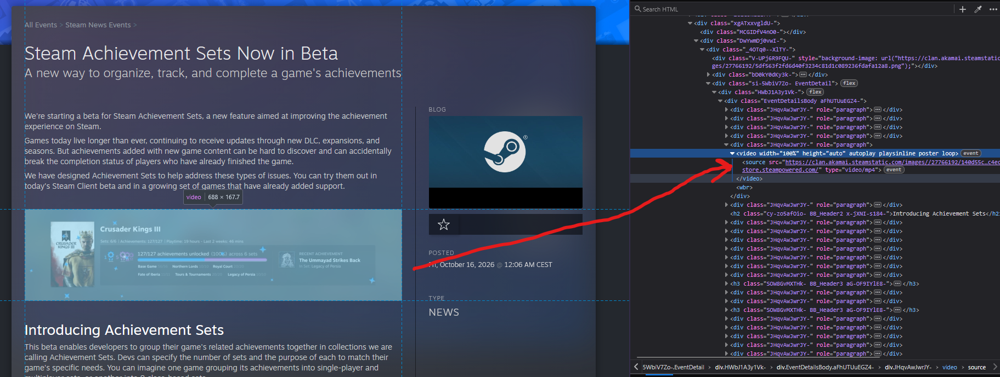
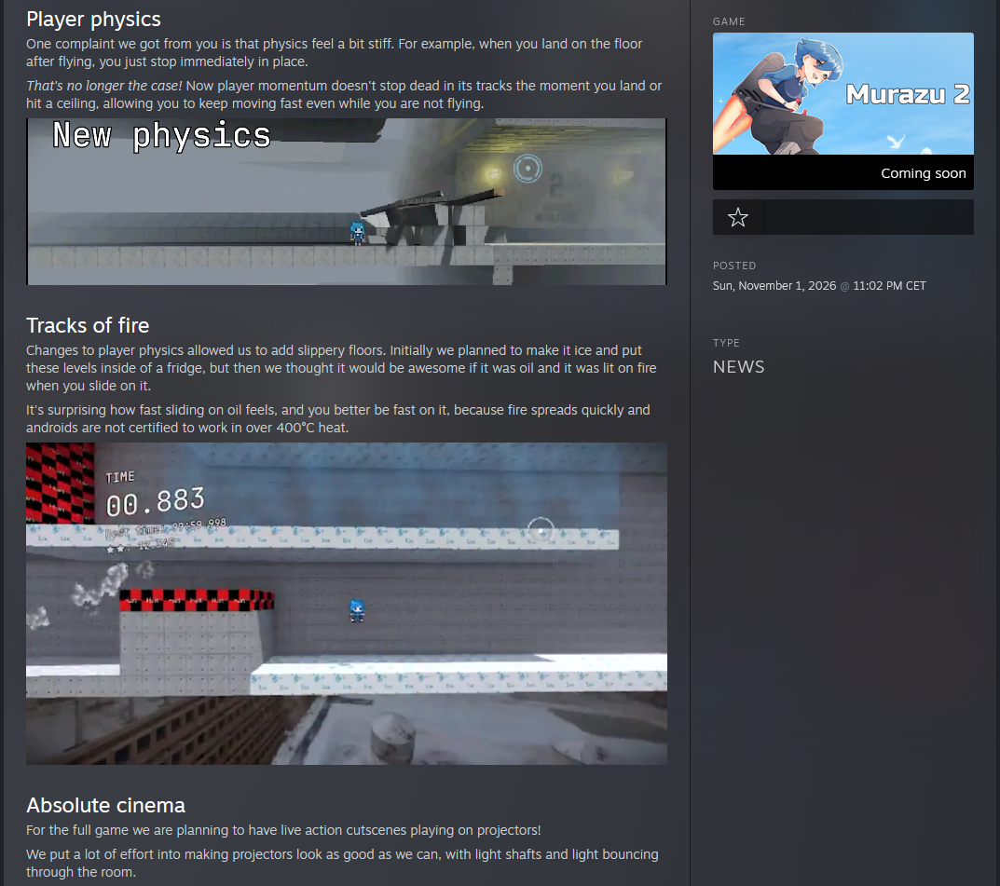

# Get to the point

Use `[video]` bbcode tag.

Example: `[video controls="false"]https://murazu.detta.dev/steam_posts/october-2026/secret.mp4[/video]`

It accepts following params:

| Param | Description | Example |
| --- | --- | --- |
| `webm` | Link to WEBM video | `[video webm="https://murazu.detta.dev/steam_posts/october-2026/secret.webm"][/video]` |
| `mp4` | Link to MP4 video | `[video mp4="https://murazu.detta.dev/steam_posts/october-2026/secret.mp4"][/video]` |
| `controls` | Hides/shows video controls, like scrollbar and pause button | `[video controls="false"]https://murazu.detta.dev/steam_posts/october-2026/secret.mp4[/video]` |
| `autoplay` | Tries to play video the moment it loads. `true` by default | `[video autoplay="false"]https://murazu.detta.dev/steam_posts/october-2026/secret.mp4[/video]` |
| `loop` | Makes the video loop. `true` by default | `[video loop="false"]https://murazu.detta.dev/steam_posts/october-2026/secret.mp4[/video]` |
| `poster` | Link to video preview image that appears while video is still loading | `[video poster="https://murazu.detta.dev/steam_posts/october-2026/secret.webp"]https://murazu.detta.dev/steam_posts/october-2026/secret.mp4[/video]` |

Make sure your host sends `Access-Control-Allow-Origin: *` header, or else Steam will show a CORS error.

# How did I get here

My game [Murazu 2](https://store.steampowered.com/app/4543000/Murazu_2/) doesn't look very impressive in screenshots, but looks a lot better in motion. The problem is that when writing Steam announcements, there are only options to include images or YouTube videos.

YouTube videos are out of the question in my case, because a whole YouTube video for a 5 second clip of a new feature is overkill. Images would be a good solution, especially with animated WebP having surprisingly good quality and acceptable file size, but Steam announcements don't support animated WebP or even animated PNG! The only animated images supported by Steam's announcement editor are GIFs which have absolutely dreadful quality and bad file size. Almost like that format is close to 40 years old.

| Format | Preview | Size |
| --- | --- | --- |
| Original MP4 | <video loop autoplay muted src="/blog/video-in-steam/oil_demo.mp4">Your browser doesn't support videos. Surprising.</video> | 1.00 MB |
| WebP |  | 5.52 MB |
| GIF |  | 8.04 MB |

# There's gotta be a better way

I knew there's no way I'm the only person who had this issue - someone must've found a solution. Google didn't bring up anything, so I just started looking through announcements of the games I own. Nothing there, it's all either static images or badly compressed GIFs.

So then I decided to look through Steam announcements and lo and behold, they use MP4s!


_Of course Valve wouldn't announce their [Steam Achievement Sets Beta](https://store.steampowered.com/news/app/593110/view/710037059469839141) with a stinky GIF. These cheaters use proper videos!_

Okay, so if Valve can do that, how can *I* do that?

I know that Steam announcement editor includes bbcode parser because there's no way they parse your bbcode server-side, so I wondered if all blog posts just ship their bbcode and parse it client-side. Turns out, that's exactly what they do. If you download a page where you view blog post and search for bbcode tags in it, like `[p]`, you will find all the post's bbcode, including their code for embedding videos:

```
[video webm="" mp4="{STEAM_CLAN_LOC_IMAGE}/27766192/2babea435b2c09d66a41f599ca28cc62580e4202.mp4" poster="" autoplay="true" controls="false"][/video]
```

`{STEAM_CLAN_LOC_IMAGE}` probably gets replaced with some Steam localized domain, but the rest is fairly obvious.

So I uploaded a few MP4s to my website, used `[video]` tag like Valve did, and I got beautiful videos playing in [my announcement](https://store.steampowered.com/news/app/4543000/view/710038961706238454?l=english).


_I'm probably one of the first developers who has videos playing in their announcements, right after Valve, obviously._

# Conclusion

Valve, please add ability to embed small videos into announcements through announcement editor UI. Modern video codecs are small enough, it's fine.

Also wishlist my [speedrunning platformer where you launch yourself like a rocket](https://store.steampowered.com/app/4543000/Murazu_2/) :D
